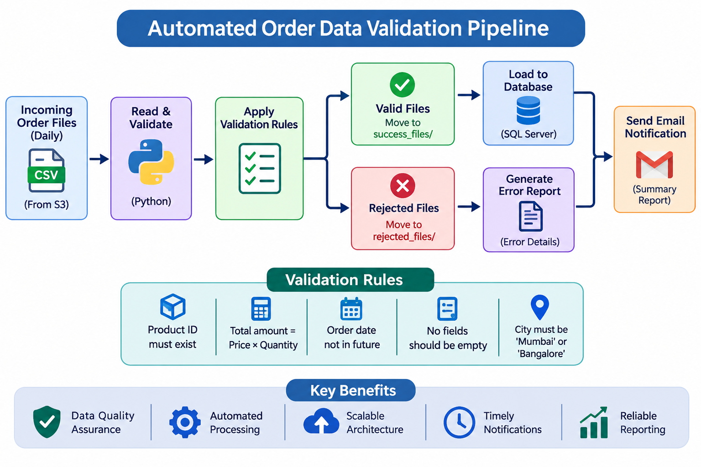

# Automated Order Data Validation Pipeline

An automated data-quality pipeline that validates daily order CSV files, routes valid and invalid files to separate Amazon S3 locations, records rejected order rows with validation reasons, loads valid orders into SQL Server, and emails a daily processing summary.

> **Portfolio project:** Python · AWS S3 · SQL Server · Data Quality · Email Automation

## Project Overview

An E-commerce / Online Retail receives daily order files from Mumbai and Bangalore. This pipeline validates each incoming file against a product master and business rules. A file is accepted only when **every order row passes validation**.

### Workflow



## Validation Rules

| Rule | Description |
|---|---|
| Product exists | `product_id` must be present in the product master |
| Amount matches | `total_sales_amount` must equal product price × quantity |
| Date is valid | `order_date` must not be in the future |
| Required fields | No order field may be empty |
| City is allowed | City must be `Mumbai` or `Bangalore` |

If any order in a file fails, the **entire file is rejected**. The rejection report contains only rejected rows and a `rejection_reason` column. Multiple reasons for a row are separated by semicolons.

## Technology Stack

- **Python** — pipeline orchestration and validation
- **Amazon S3** — incoming files, product master, success and rejected outputs
- **SQL Server** — storage for validated order records
- **pyodbc** — SQL Server connectivity
- **boto3** — AWS SDK for Python
- **SMTP / Gmail** — daily business notification

## Setup

### 1. Clone the repository

```bash
git clone https://github.com/AnalyticswithPrajwal/automated-order-data-validation-pipeline.git
cd automated-order-data-validation-pipeline
```

### 2. Create and activate a virtual environment

```bash
python -m venv .venv
```

Windows PowerShell:

```powershell
.\.venv\Scripts\Activate.ps1
```

macOS / Linux:

```bash
source .venv/bin/activate
```

### 3. Install dependencies

```bash
pip install -r requirements.txt
```

You also need a compatible Microsoft SQL Server ODBC driver installed on the machine. The current connector uses **ODBC Driver 17 for SQL Server**.

### 4. Configure credentials

Copy the example configuration:

```bash
# Windows
copy config.ini.example config.ini

# macOS / Linux
cp config.ini config.ini
```

Fill in your local values in `config.ini`. Keep this file out of Git.

Example configuration (use placeholders in the committed example):

```ini
[aws]
access_key = YOUR_AWS_ACCESS_KEY
secret_key = YOUR_AWS_SECRET_KEY

[gmail_app_password]
password = YOUR_GMAIL_APP_PASSWORD

[database_verification]
server = YOUR_SQL_SERVER
database = python_project
driver = ODBC Driver 17 for SQL Server
trusted_connection = yes
```

> Adapt the configuration keys to the implementation. At present, some values (such as bucket name, SQL Server instance, sender, and recipient) are hardcoded in the Python files and should be moved into configuration before running this template.

### 5. Prepare AWS S3

Create or configure the bucket and upload the product master file. The pipeline expects the following key structure:

```text
s3://<bucket>/
├── product_master.csv
├── incoming_files/
│   └── YYYYMMDD/
│       └── orders_*.csv
├── success_files/
│   └── YYYYMMDD/
└── rejected_files/
    └── YYYYMMDD/
        ├── orders_*.csv
        └── error_orders_*.csv
```

The date folder uses `YYYYMMDD`. Ensure the incoming files and product master have the expected headers and formats.

### 6. Prepare SQL Server

Create the target database and an `orders` table whose columns match the order schema:

```sql
CREATE TABLE orders (
    order_id VARCHAR(50),
    order_date DATE,
    product_id VARCHAR(50),
    quantity INT,
    total_sales_amount DECIMAL(12, 2),
    city VARCHAR(50)
);
```

Adjust data types and constraints to your data. The Python insert statement and table column order/types must agree.

### 7. Run the pipeline

```bash
python validator_main.py
```

The pipeline processes the current day's S3 incoming folder, stores valid records in SQL Server, writes rejection reports for invalid files, and sends an email summary.

## Output and Notifications

### Successful file

```text
success_files/YYYYMMDD/orders_file.csv
```

### Rejected file and report

```text
rejected_files/YYYYMMDD/orders_file.csv
rejected_files/YYYYMMDD/error_orders_file.csv
```

The error report includes the original rejected order fields and `rejection_reason`.

### Daily email

Example:

```text
Subject: validation email YYYY-MM-DD

Total 10 incoming files processed.
8 files passed validation.
2 files failed validation.
```

If no files are found:

```text
No incoming files found for YYYY-MM-DD.
```

## Security

- Never commit `config.ini`, `.env`, AWS keys, Gmail app passwords, database passwords, or production data.
- Use least-privilege AWS IAM permissions for the S3 bucket.
- Rotate any credential that has been exposed.
- Prefer environment variables, AWS IAM roles, or AWS Secrets Manager for credentials in production.
